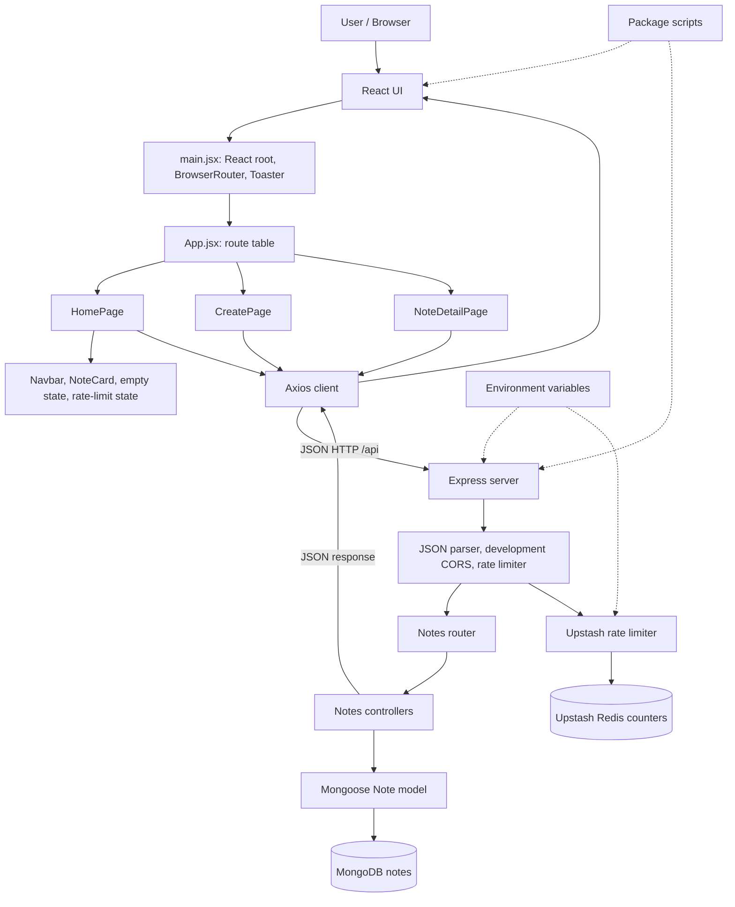

# ThinkBoard: Project and Architecture Guide

This document explains the current ThinkBoard repository for project walkthroughs and software engineering interviews. It is based on the checked-in source, README, package manifests, and lockfiles. The supplied architecture image is included below and explained against the source code.

The image is an architecture reference. Its labels are not treated as implementation instructions: where a label differs from the code, the current code is described explicitly.

## 1. Project overview

ThinkBoard is a small full-stack notes app. A browser user can list notes, create one, open it, edit it, or delete it. The server persists notes in MongoDB. The app also has a request rate limiter backed by Upstash Redis.

The problem it addresses is simple: provide a web interface and API for keeping and managing short text notes. It is also a learning project for the MERN stack and REST APIs, as stated in the [README](../README.md). The implementation has no authentication, user identity, note ownership, sharing, or collaboration. Avoid describing it as a private or multi-user notes service.

The persisted note fields are title and content, both required strings. Mongoose adds createdAt and updatedAt timestamps. The UI shows the creation date.

### A 60-second explanation

> ThinkBoard is a full-stack note-taking app. The React frontend lets a user browse notes, create one, open it to edit, or delete it. It sends JSON requests through Axios to an Express API running on Node.js. The API routes each request to a controller, and the controller uses a Mongoose model to read or write notes in MongoDB. Each note has a required title and content field, plus automatic timestamps. The backend also checks requests against an Upstash Redis rate limit. The frontend handles loading and empty states and shows toast messages for outcomes. It is a focused CRUD app: the current code does not include accounts, note ownership, or collaboration.

### A two-minute explanation

> ThinkBoard is a small notes application with a React frontend and an Express API. The home page fetches notes and displays them as cards, sorted newest first. A create page collects a title and content, while a detail page loads a note by ID and supports editing or deletion.
>
> The frontend uses a shared Axios client. In development it points to the local backend; in production it uses a relative /api path. Express mounts the notes router under /api/notes. The router maps HTTP methods to controller functions: GET for listing and reading, POST for creating, PUT for updating, and DELETE for removing a note.
>
> The controller uses a Mongoose Note model. Its schema requires title and content and enables createdAt and updatedAt timestamps. The server connects to MongoDB before it starts listening. Separately, global Express middleware checks requests with an Upstash Redis rate limiter configured for a sliding window of 100 requests per 60 seconds. The current middleware uses one fixed limiter identifier, so its quota is shared rather than tracked per user or IP.
>
> The app is intentionally small. The code does not include authentication, note ownership, pagination, or a custom centralized error handler. Those are concrete areas to discuss as possible next improvements.

Use “I built” or describe your personal contribution only if that accurately reflects your work. The repository and this conversation do not establish who authored each part.

## 2. Technologies, versions, and installation

The exact versions below come from package-lock.json. The manifests use semver ranges such as ^1.9.0; the lockfiles resolve those ranges to exact versions. Frontend and backend have separate manifests and lockfiles: [frontend/package.json](../frontend/package.json), [frontend/package-lock.json](../frontend/package-lock.json), [backend/package.json](../backend/package.json), and [backend/package-lock.json](../backend/package-lock.json).

### Direct runtime dependencies

| Area | Direct package and locked version | Role in this project |
|---|---|---|
| UI library | React 19.1.0 | Renders the page and component tree. |
| Browser renderer | React DOM 19.1.0 | Mounts React into the HTML document. |
| Routing | React Router 7.6.0 | Routes /, /create, and /note/:id to pages. The source imports from react-router. |
| HTTP client | Axios 1.9.0 | Sends frontend requests to the backend through a shared configured client. |
| Icons | lucide-react 0.510.0 | Supplies icons in navigation, cards, and pages. |
| Notifications | react-hot-toast 2.5.2 | Displays success and error messages. |
| HTTP server framework | Express 4.18.2 | Defines the backend app, middleware pipeline, and REST routes. |
| MongoDB object mapper | Mongoose 8.14.3 | Defines the Note schema and performs database reads and writes. |
| Cross-origin support | cors 2.8.5 | Sets browser CORS headers for the configured development origins. |
| Environment loader | dotenv 16.5.0 | Loads server settings from environment variables. |
| Rate-limiter logic | @upstash/ratelimit 2.0.5 | Implements a 100-request, 60-second sliding window. |
| Redis REST client | @upstash/redis 1.34.9 | Connects the limiter to the Upstash Redis service over REST. |

### Direct development and build dependencies

| Area | Direct package and locked version | Role |
|---|---|---|
| Frontend dev server and build | Vite 6.3.5 | Serves the frontend during development and creates the production build. |
| React integration for Vite | @vitejs/plugin-react 4.4.1 | Configures Vite’s React support. |
| Utility CSS | Tailwind CSS 3.4.17 | Provides utility classes and CSS directives. |
| Component styles and theme | DaisyUI 4.12.24 | Provides component classes; the configured theme is forest. |
| CSS processing | PostCSS 8.5.3 | Runs the CSS processing pipeline. |
| Browser prefixes | Autoprefixer 10.4.21 | Adds CSS vendor prefixes during processing. |
| Linter | ESLint 9.26.0 | Checks JavaScript and JSX. |
| ESLint base rules | @eslint/js 9.26.0 | Supplies standard JavaScript ESLint rules. |
| React Hooks lint rules | eslint-plugin-react-hooks 5.2.0 | Adds checks for Hooks usage. |
| React refresh lint rules | eslint-plugin-react-refresh 0.4.20 | Checks patterns used by React Fast Refresh. |
| ESLint globals | globals 16.1.0 | Defines recognized global names for ESLint. |
| React type definitions | @types/react 19.1.4 | Development-time type definitions; application source is JavaScript/JSX. |
| React DOM type definitions | @types/react-dom 19.1.5 | Development-time type definitions; application source is JavaScript/JSX. |
| Backend auto-restart | Nodemon 3.1.10 | Restarts the backend during development when files change. |

The backend also resolves transitive packages in its lockfile. For example, mongodb 6.16.0 and bson 6.10.3 are dependencies below Mongoose; body-parser 1.20.1 is below Express. The frontend lockfile resolves esbuild 0.25.4 and rollup 4.40.2 below the build tooling. These are installed through the dependency tree but are not direct entries in the project manifests. The mongodb package is the Node driver; the MongoDB server’s own version is not specified here.

Node’s built-in path module is imported by the backend and does not need npm installation.

### Node.js and npm on this machine

The current shell reported Node.js 24.11.1 and npm 11.6.2. These are machine versions observed while preparing this guide, not versions pinned by the project and not proof of which versions were used when the project was first created. The package manifests do not declare a Node.js engine version.

### Installation commands: documented versus known history

No install command is recorded in this conversation, and no install was run while preparing this guide. Therefore, which commands were historically run is unknown. The README documents these commands and their working folders:

| Working folder | README-documented commands |
|---|---|
| backend | npm install, then npm run dev |
| frontend | npm install, then npm run dev |

In other words, the documented install location is the backend folder for backend dependencies and the frontend folder for frontend dependencies. The root also contains a package.json named backend, but the README’s setup steps target the two subfolders and their lockfiles. The repository does not prove that the documented commands were actually executed.

### Styling, routing, HTTP, build, and development tools

- **Styling:** Tailwind CSS, DaisyUI, PostCSS, and Autoprefixer. Tailwind’s directives are in frontend/src/index.css; DaisyUI is configured with the forest theme.
- **Routing:** React Router. BrowserRouter is set up in main.jsx; App.jsx declares the three page routes.
- **HTTP:** Axios on the frontend and Express on the backend. Requests and responses use JSON for the notes API.
- **Database access:** Mongoose connects the Node server to MongoDB.
- **Rate limiting:** Upstash Ratelimit uses Upstash Redis for shared counter state.
- **Frontend build:** Vite and @vitejs/plugin-react. The frontend manifest defines dev, build, lint, and preview scripts.
- **Backend development:** Nodemon is used by the backend dev script. The backend manifest also defines a start script using Node.
- **Production serving:** server.js serves frontend/dist when NODE_ENV is production, alongside the API.

## 3. Architecture diagram and how the components link

### Supplied diagram

The image is useful as a map of the intended system. The checked-in source remains the authority for exact paths, methods, and package scripts. A compact request-flow version is:

### What each diagram component does

#### Browser and frontend container

- **User / Browser:** The person interacts with the rendered pages. BrowserRouter uses the browser URL to select the current page.
- **React Frontend / Vite app:** React renders the UI. Vite serves it in development and builds the static frontend files for production. Tailwind and DaisyUI provide most layout and component styling; PostCSS and Autoprefixer process the CSS.
- **Bootstrap (main.jsx):** The entry point creates the React root, wraps the app in BrowserRouter, imports the main stylesheet, and mounts the toast notification layer.
- **App shell / routing (App.jsx):** Defines the page routes: / maps to HomePage, /create maps to CreatePage, and /note/:id maps to NoteDetailPage.
- **Pages:** HomePage fetches and lists notes; CreatePage submits a new note; NoteDetailPage fetches an individual note and supports save and delete actions.
- **UI components:** Navbar links to the create page. NoteCard shows a note and supports deleting it from the list. NotesNotFound is the empty-list state. RateLimitedUI displays the home-page response to HTTP 429.
- **Axios client:** frontend/src/lib/axios.js centralizes the API base URL. Development uses http://localhost:5001/api; production uses /api. Pages call the client rather than constructing the backend URL independently.
- **Utilities:** frontend/src/lib/utils.js formats the note’s createdAt date for display.

#### Backend container

- **Express API server (server.js):** Loads environment configuration, creates the app, configures CORS in non-production mode, parses JSON, registers the global limiter, mounts /api/notes, and listens on PORT or 5001. In production it serves the built frontend.
- **Middleware pipeline:** express.json() makes request JSON available as req.body. Development CORS allows http://localhost:5173 and http://127.0.0.1:5173. The rate limiter runs before the notes routes.
- **Notes routes:** Maps GET /, GET /:id, POST /, PUT /:id, and DELETE /:id under the /api/notes prefix to controller functions.
- **Notes controllers:** Implement list, read-one, create, update, and delete behavior. They return JSON and statuses such as 200, 201, 404, and 500.
- **Note model / schema:** Mongoose defines the required title and content fields and adds timestamps. Controllers use the model to query or modify records.
- **MongoDB connection:** config/db.js calls mongoose.connect using MONGO_URI. The server starts listening only after the connection succeeds.

#### External services and configuration

- **MongoDB:** Stores note documents. CRUD controller operations flow through Mongoose into MongoDB.
- **Upstash Redis:** Stores the shared rate-limit state used by the Upstash rate-limiter package. The limiter sends rate-limit operations to Redis; it does not store note titles or content there.
- **Environment variables:** MONGO_URI configures MongoDB. UPSTASH_REDIS_REST_URL and UPSTASH_REDIS_REST_TOKEN configure the Redis REST client. NODE_ENV selects development or production behavior. PORT is optional and defaults to 5001.
- **Package scripts:** These are launch and build commands, not runtime components. The frontend package has Vite dev/build/lint/preview scripts. The backend package has Nodemon dev and Node start scripts.

### How one create request traverses the diagram

1. The user fills title and content on CreatePage. The page keeps these values in React state and checks that they are not blank after trimming.
2. On submit, it calls Axios with POST /notes and a JSON body. Axios prefixes the configured API base URL.
3. Express receives POST /api/notes, parses JSON, and runs the global rate-limiter middleware.
4. If the limiter allows the request, Express routes it to createNote.
5. createNote constructs a Mongoose Note and saves it to MongoDB.
6. MongoDB returns the saved document; the controller responds with status 201 and JSON.
7. Axios resolves in the browser. The page displays a success toast and navigates to /. HomePage then fetches the note list again.

For reading, editing, and deleting, the same path is used with GET, PUT, and DELETE requests. Detail-page requests include the note ID in the URL.

### Diagram details to correct or qualify against the source

1. **Package scripts:** The image calls these “Root Scripts”. The checked-in frontend/package.json contains Vite dev/build/lint/preview scripts. backend/package.json contains Nodemon dev and Node start scripts. The root package.json is named backend and repeats backend-style scripts; it is not the frontend build manifest.
2. **Update method:** The image says PUT/PATCH for the detail update. The current router implements PUT /:id only. There is no PATCH route.
3. **Shared quota:** The diagram correctly shows Redis counters, but the code uses the same fixed limiter identifier for all callers. It does not create one counter per IP or account.
4. **Global middleware:** The rate limiter is registered with app.use before both API routes and production static serving. As written, it can run for static-file requests as well as API requests.
5. **Production path:** In production, Express serves frontend/dist. This same-origin setup matches the frontend Axios client’s relative /api URL. In development, Vite and Express run separately, and CORS allows the configured local frontend origins.

## 4. Routes, data, and error behavior

### UI routes

| Browser path | Component | Main behavior |
|---|---|---|
| / | HomePage | Fetches all notes and renders cards, loading, empty, and rate-limit states. |
| /create | CreatePage | Validates title/content presence and creates a note. |
| /note/:id | NoteDetailPage | Fetches one note, edits it with PUT, or deletes it. |

### API routes

All notes routes are mounted under /api/notes.

| Method and path | Behavior | Main success/not-found response |
|---|---|---|
| GET /api/notes | List notes newest first | 200 and a JSON array |
| GET /api/notes/:id | Fetch one note | 200 with note; 404 if missing |
| POST /api/notes | Create note from title/content | 201 with saved note |
| PUT /api/notes/:id | Update title/content | 200 with updated note; 404 if missing |
| DELETE /api/notes/:id | Delete note | 200 with message; 404 if missing |

The list controller sorts by createdAt descending. The update controller asks Mongoose to return the updated record. It does not enable runValidators in findByIdAndUpdate. The schema and route/controller implementation are in [Note.js](../backend/src/models/Note.js), [notesRoutes.js](../backend/src/routes/notesRoutes.js), and [notesController.js](../backend/src/controllers/notesController.js).

### Error handling as implemented

- The controllers catch database and other errors, log them, and generally return a generic 500 response.
- Missing records return 404.
- There is no explicit request-validation layer or custom centralized Express error handler.
- Invalid IDs can throw a Mongoose cast error that falls into the controller’s general catch and is treated as a 500.
- The frontend uses toast notifications. The home page recognizes 429 and shows RateLimitedUI; the create page has a specific slow-down toast for 429. Other failures generally receive a generic user-facing message.

These are useful interview talking points: describe current behavior first, then explain how you would add validation, consistent error mapping, and centralized logging.

## 5. Imports and external connections

### Important third-party imports

| Package | Main import locations | Purpose |
|---|---|---|
| express | backend/src/server.js, backend/src/routes/notesRoutes.js | HTTP app and router. |
| cors | backend/src/server.js | Development cross-origin response headers. |
| dotenv | backend/src/server.js, backend/src/config/upstash.js | Loads backend environment variables. |
| mongoose | backend/src/config/db.js, backend/src/models/Note.js | Mongo connection, schema, model, and queries. |
| @upstash/ratelimit | backend/src/config/upstash.js | Defines the sliding-window limiter. |
| @upstash/redis | backend/src/config/upstash.js | Redis REST client used by the limiter. |
| react and react-dom | frontend/src/main.jsx and page components | React UI and DOM mounting. |
| react-router | frontend/src/main.jsx, App.jsx, and navigation/page components | Browser routing and navigation. |
| axios | frontend/src/lib/axios.js | Shared HTTP client. Pages import the project’s local api client. |
| react-hot-toast | frontend/src/main.jsx and page components | Toast notifications. |
| lucide-react | Frontend pages and components | Icons. |
| Vite and @vitejs/plugin-react | frontend/vite.config.js | Frontend development server and build configuration. |
| Tailwind CSS, DaisyUI, PostCSS, Autoprefixer | frontend CSS and configuration files | CSS utilities, theme/components, and processing. |

### Internal project imports

- **Backend:** server.js imports routes/notesRoutes.js, config/db.js, and middleware/rateLimiter.js. The router imports controllers/notesController.js. The controller imports models/Note.js. The rate-limit middleware imports config/upstash.js.
- **Frontend:** main.jsx imports index.css and App.jsx. App.jsx imports the three page components. HomePage imports Navbar, NoteCard, NotesNotFound, RateLimitedUI, and the Axios client. CreatePage and NoteDetailPage also import the Axios client. NoteCard imports the date utility.

### When MongoDB and Upstash are used

- **MongoDB connection:** On backend startup, server.js calls connectDB(). config/db.js passes MONGO_URI to mongoose.connect. The HTTP server starts listening after the database connection succeeds. CRUD requests later use the Mongoose model to access notes.
- **Upstash configuration:** The Upstash module creates a Redis REST client from environment variables and configures the Ratelimit instance. Actual limiter operations occur when requests pass through rateLimiter middleware. Redis receives rate-limit identifiers/counter operations, not the note body.
- **Environment names:** MONGO_URI, UPSTASH_REDIS_REST_URL, UPSTASH_REDIS_REST_TOKEN, NODE_ENV, and optional PORT. This document does not include values from .env.

### Installing versus importing versus connecting

- **Installing a package** adds it to a project’s dependency tree, as described by package.json and the lockfile.
- **Importing a package** makes it available to a source module, for example importing mongoose in the model.
- **Connecting to an external service** configures or sends requests to a service outside the application. Mongoose connects to MongoDB at server startup; the Redis REST client makes rate-limit calls when middleware runs.

## 6. Tutorial stages and timeline

The supplied YouTube URL starts at 757 seconds, which is 12:37 and falls inside the tutorial’s backend setup and basics section. The chapter sequence below comes from the linked tutorial listing, not from repository commit history. [Watch from 12:37](https://www.youtube.com/watch?v=F9gB5b4jgOI&t=757s) · [Chapter outline](https://ceppek.com/2025/06/10/mern-stack-tutorial-for-beginners-with-deployment-2025/)

| Video time | Major stage |
|---|---|
| 00:00 | Project preview |
| 01:32 | Backend setup and basics |
| 25:39 | Nodemon and routes |
| 32:35 | File and folder structure |
| 43:52 | MongoDB setup |
| 1:03:50 | Controllers |
| 1:25:48 | Middleware and rate limiting |
| 1:45:52 | React frontend setup |
| 2:02:00 | Home page |
| 2:31:23 | Create page |
| 2:49:14 | Delete functionality |
| 2:57:01 | Note detail page |
| 3:11:26 | Deployment |

The sequence is backend foundation → routes and data access → middleware/rate limiting → frontend pages and CRUD actions → deployment. It is a summary of the tutorial’s stages, not evidence of which steps a particular person completed or when.

## 7. Interview practice

### Architecture

**Q: Walk me through the architecture.**  
**A:** “The browser renders React pages. They call Axios, which sends HTTP requests to Express. Express runs middleware and routes the request to a controller. The controller uses the Mongoose model to access MongoDB. The rate-limit middleware checks Upstash Redis separately before the route runs.”

**Q: Why have routes, controllers, and models?**  
**A:** “Routes map URL and method combinations to handlers. Controllers implement request behavior and response status codes. The model describes the note shape and database operations. That separation makes each layer easier to locate and change.”

**Q: What happens on startup?**  
**A:** “The backend loads environment variables, configures the app and middleware, connects Mongoose to MongoDB, then begins listening after the connection succeeds. If the Mongo connection fails, the code logs the error and exits.”

### Data and API

**Q: What fields are stored for each note?**  
**A:** “The schema requires title and content. Mongoose timestamps add createdAt and updatedAt. There is no owner or user ID field.”

**Q: Why MongoDB instead of SQL?**  
**A:** “The implementation uses MongoDB for simple note records, but the repository does not record the original decision rationale. For this small shape, a document store is straightforward. If the app needed relationships, relational constraints, or complex joins, I would reassess.”

**Q: How is the API designed?**  
**A:** “It uses a notes resource: GET lists or fetches, POST creates, PUT updates, and DELETE removes. The note ID is in the path for individual-note operations.”

**Q: Does the API support PATCH?**  
**A:** “No. The diagram mentions PUT/PATCH, but the source registers PUT /:id only.”

### Errors, CORS, and rate limiting

**Q: How are errors handled?**  
**A:** “Missing notes return 404. Controller exceptions are logged and generally returned as a generic 500. There is no custom centralized error handler or comprehensive request validation. I would make invalid input and malformed IDs produce consistent 4xx responses.”

**Q: What is CORS doing?**  
**A:** “In non-production mode, the backend allows the configured Vite origins on localhost:5173 and 127.0.0.1:5173. In production, Express serves the frontend and API from the same server, and the frontend uses a relative /api URL. CORS is a browser cross-origin policy, not authentication.”

**Q: How does rate limiting work?**  
**A:** “A global middleware uses Upstash Ratelimit with Redis and a sliding window of 100 requests per 60 seconds. Rejected requests receive 429. The current implementation uses one fixed identifier for all requests, so everyone shares the quota; it is not per user or IP.”

**Q: What happens if Upstash is unavailable?**  
**A:** “The middleware logs the limiter error and calls next(error). There is no custom error handler or explicit fallback policy, so the error is left to Express’s default error handling. I would decide whether to fail closed or temporarily allow requests and document that choice.”

### Environment and tradeoffs

**Q: How is configuration handled?**  
**A:** “The backend uses dotenv. MONGO_URI configures MongoDB, and UPSTASH_REDIS_REST_URL plus UPSTASH_REDIS_REST_TOKEN configure the Redis REST client. NODE_ENV controls development/production branches. PORT is optional and defaults to 5001. Secret values should stay out of source control.”

**Q: What are the main limitations?**  
**A:** “There is no authentication or note ownership, so notes are not isolated by user. The API does not paginate the list, validation and error mapping are basic, and the limiter uses one shared key. Those are specific next steps if the app were extended.”

**Q: Why use Axios?**  
**A:** “The project centralizes its base URL in one Axios client, so page components can use relative API paths and the client selects the local backend in development or /api in production.”

**Q: What tests or scripts can you point to?**  
**A:** “The frontend manifest has dev, build, lint, and preview scripts. The backend manifest has dev and start scripts. The manifests shown here do not define a test script.”

## 8. Final recall checklist

- Explain the flow: **React page → Axios → Express middleware → route → controller → Mongoose → MongoDB → JSON response → UI**.
- Mention Redis separately: it stores rate-limit state, not notes.
- Say **content**, not description, for the stored note body.
- The implemented update route is **PUT**; there is no PATCH route.
- The limiter is **100 requests per 60 seconds**, using one shared identifier.
- Node.js 24.11.1 and npm 11.6.2 were observed on this machine during guide preparation; neither is pinned by this project.
- The README documents installs from backend and frontend directories, but actual prior install commands are unknown from this conversation.
- Do not claim authentication, per-user data, deployment provider, tests, authorship, or personal implementation details unless separately verified.
